 

<!-- Quick Connect & Socials -->

  
  &nbsp;
  
  &nbsp;
  
  &nbsp;
  

 

---

### `roxy@github ~ $ whoami`

<table>
  <tr>
    <td valign="top" align="center"></td>
    <td valign="top" align="center"></td>
  </tr>
</table>

 

---

### `roxy@github ~ $ cat tech-stack.sh`

 

---

### `roxy@github ~ $ gh api stats`

 

### `roxy@github ~ $ git log --language-breakdown`

 

---

### `roxy@github ~ $ ./showcase_projects.sh`

 

---

### `roxy@github ~ $ ./matrix.sh`

 

---

### `roxy@github ~ $ ./contributions.sh`

 

---

### `roxy@github ~ $ ./commit-invaders.sh`

 

---

  

⚡ Crafted with dynamic SVG generators • Auto-updating via GitHub Actions • © 2026 RoxyBasicNeedBot

